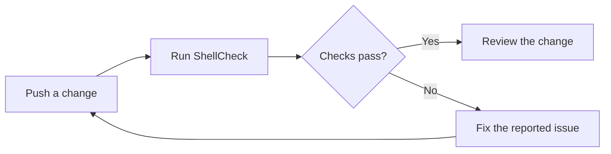

A good first pipeline answers one question: **does this change pass the checks we agreed on?** It does not need to deploy, publish packages, or manage five environments.

This example checks shell scripts with ShellCheck. It is intentionally small enough to explain line by line.

## Prerequisites

- A GitLab project with an available Linux Docker runner.
- At least one shell script directly inside a `scripts/` directory.
- Permission for the runner to download an Alpine image and install packages.

## Start with one job

Create `.gitlab-ci.yml` at the root of your GitLab repository:

```yaml
stages:
  - check

shellcheck:
  stage: check
  image: alpine:3.22
  before_script:
    - apk add --no-cache shellcheck
  script:
    - shellcheck scripts/*.sh
```

`stages` defines the order of work. `shellcheck` is the job name. The image provides the environment, and `script` contains the command whose exit status determines success.

If there are no matching scripts, this job should fail rather than report a misleading green result. Adjust the path to match your actual project.

## Make the feedback loop explicit



A failed check is information, not something to hide with `|| true`. Open the job log, identify the first actionable error, and reproduce it locally:

```sh
shellcheck scripts/*.sh
```

The local command and CI command should stay aligned. Otherwise, “works on my machine” becomes a predictable outcome.

## Verify the pipeline

1. Use GitLab's CI Lint or pipeline editor to validate the configuration.
2. Push a branch with a valid script. Expect a passing job.
3. Introduce a ShellCheck violation, such as an unquoted variable expansion. Expect the job to fail.
4. Fix it and confirm the pipeline turns green.

This checks the failure path, not just the happy path.

## What to add next

Add a test job when you have tests. Add a build job when you have something to build. Use a prebuilt tool image or pin an image digest when reproducibility becomes important.

Keep credentials out of the YAML file. Deployment secrets belong in GitLab's CI/CD variables with the appropriate protection and environment scope.

The goal is not a sophisticated pipeline. It is a trustworthy feedback loop.
