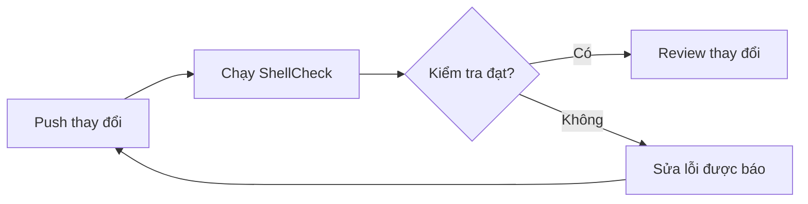

Pipeline đầu tiên nên trả lời một câu hỏi: **thay đổi này có vượt qua những kiểm tra đã thống nhất không?** Chưa cần triển khai, xuất bản package hay quản lý nhiều môi trường.

Ví dụ này dùng ShellCheck để kiểm tra shell script. Cấu hình đủ nhỏ để giải thích từng dòng.

## Điều kiện cần

- Một dự án GitLab có Linux Docker runner hoạt động.
- Ít nhất một shell script nằm trực tiếp trong thư mục `scripts/`.
- Runner được phép tải image Alpine và cài package.

## Bắt đầu với một job

Tạo `.gitlab-ci.yml` ở thư mục gốc của repository GitLab:

```yaml
stages:
  - check

shellcheck:
  stage: check
  image: alpine:3.22
  before_script:
    - apk add --no-cache shellcheck
  script:
    - shellcheck scripts/*.sh
```

`stages` xác định thứ tự thực hiện. `shellcheck` là tên job. Image cung cấp môi trường; lệnh trong `script` quyết định job thành công hay thất bại qua mã thoát.

Nếu không có script phù hợp, job nên thất bại thay vì báo thành công sai lệch. Hãy điều chỉnh đường dẫn theo dự án của bạn.

## Làm rõ vòng phản hồi



Kiểm tra thất bại là thông tin hữu ích, không phải thứ nên che đi bằng `|| true`. Mở log, tìm lỗi đầu tiên có thể xử lý và tái hiện trên máy:

```sh
shellcheck scripts/*.sh
```

Lệnh chạy trên máy và trong CI nên giống nhau. Nếu không, tình trạng “máy tôi vẫn chạy” rất dễ xảy ra.

## Kiểm chứng pipeline

1. Dùng CI Lint hoặc pipeline editor của GitLab để kiểm tra cấu hình.
2. Push một branch có script hợp lệ. Job phải thành công.
3. Thêm lỗi ShellCheck, ví dụ mở rộng biến mà không có dấu ngoặc kép. Job phải thất bại.
4. Sửa lỗi và xác nhận pipeline thành công trở lại.

Như vậy, bạn đã kiểm tra cả đường đi thất bại chứ không chỉ trường hợp thuận lợi.

## Bước tiếp theo

Thêm job test khi đã có test. Thêm job build khi thực sự cần build. Dùng image chứa sẵn công cụ hoặc ghim digest của image khi cần tăng khả năng tái lập.

Không đặt thông tin bí mật trong YAML. Dùng CI/CD variables của GitLab với chế độ bảo vệ và phạm vi môi trường phù hợp.

Mục tiêu không phải pipeline cầu kỳ, mà là vòng phản hồi đáng tin cậy.
